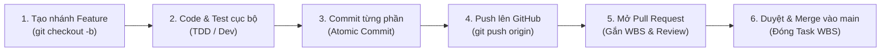

# 🌿 QUY CHUẨN QUẢN TRỊ MÃ NGUỒN & GIT WORKFLOW DOANH NGHIỆP

> **Dự án**: Hệ sinh thái đặt món ăn trực tuyến tích hợp AI – **GuGuGaGa**  
> **Mục tiêu**: Chuẩn hóa quy trình tạo nhánh (Branching), Commit nguyên tử (Atomic Commits), Mở Pull Request (PR), Đánh giá chéo (Code Review) và Hợp nhất (Merge) gắn liền với cây phân rã công việc **WBS**.

---

## 1. MÔ HÌNH NHÁNH (BRANCHING STRATEGY)

Dự án áp dụng mô hình **Trunk-Based / GitHub Flow mở rộng** kết hợp tiền tố WBS:

```
[main] ────────────────●───────────────────────●───────────────────────●─── (Production Ready / Tag Release)
                       ▲                       ▲                       ▲
                       │ [PR Merge #1]         │ [PR Merge #2]         │ [PR Merge #3]
feat/wbs-1.1.1-infra ──┴───────                │                       │
                                               │                       │
feat/wbs-1.2.1-auth ───────────────────────────┴───────                │
                                                                       │
feat/wbs-1.3.6-camera-ai ──────────────────────────────────────────────┴───────
```

### 1.1. Quy ước đặt tên nhánh (Branch Naming Convention):
* **Nhánh chính (Production)**: `main` (Luôn ở trạng thái có thể chạy và triển khai được).
* **Nhánh tính năng (Feature)**:
  `feat/wbs-<Mã_WBS>-<ten-ngan-gon-tieng-anh>`
  * *Ví dụ*: `feat/wbs-1.1.1-repo-infra`, `feat/wbs-1.2.1-auth-jwt`, `feat/wbs-1.2.4-vietqr-casso`, `feat/wbs-1.3.6-camera-ai-scan`.
* **Nhánh sửa lỗi (Bugfix)**:
  `fix/wbs-<Mã_WBS>-<ten-loi>`
  * *Ví dụ*: `fix/wbs-1.2.3-order-total-calc`, `fix/wbs-1.4.2-shipper-race-condition`.
* **Nhánh tối ưu hóa / Refactor**:
  `refactor/wbs-<Mã_WBS>-<ten-module>`
* **Nhánh tài liệu / cấu hình CI/CD**:
  `docs/wbs-<Mã_WBS>-<ten-tai-lieu>`, `chore/wbs-1.1.1-ci-pipeline`.

---

## 2. QUY CHUẨN COMMIT (CONVENTIONAL COMMITS v1.0)

Mỗi commit là một điểm lưu an toàn (**Save Point**) độc lập, giải thích rõ **Lý do (Why)** thay vì chỉ nói **Làm gì (What)**.

### Cú pháp chuẩn:
```
<type>(wbs-<Mã_WBS>): <mô tả ngắn bằng tiếng Việt hoặc tiếng Anh>

[Tùy chọn: Mô tả chi tiết lý do thay đổi và cách giải quyết]
```

### Bảng phân loại `type`:
| Type | Ý nghĩa | Ví dụ |
| :--- | :--- | :--- |
| `feat` | Thêm tính năng mới theo WBS | `feat(wbs-1.2.1): tich hop bcrypt ma hoa mat khau nguoi dung` |
| `fix` | Sửa lỗi phát sinh | `fix(wbs-1.2.4): xu ly truong hop Casso gui duplicate webhook` |
| `refactor` | Tái cấu trúc code (không đổi logic nghiệp vụ) | `refactor(wbs-1.2.2): tach logic upload anh sang upload.service.js` |
| `test` | Viết thêm hoặc sửa Unit / E2E Test | `test(wbs-1.7.1): bo sung kich ban smoke test luong dat mon` |
| `docs` | Viết hoặc cập nhật tài liệu | `docs(wbs-1.1.1): cap nhat file WBS_Project_Management.md` |
| `chore` | Cấu hình linter, dependencies, build tool | `chore(wbs-1.1.1): them quy tac gitignore cho cac file secret` |

---

## 3. QUY TRÌNH 6 BƯỚC LÀM VIỆC CHUẨN THỰC TẾ (WORKFLOW LIFECYCLE)

Khi nhận một gói công việc từ `tasks/todo.md`, mỗi thành viên thực hiện nghiêm ngặt theo chu trình:



### Bước 1: Đồng bộ mã nguồn mới nhất & Tạo nhánh Feature
```bash
# 1. Chuyển về nhánh main và lấy mã nguồn mới nhất
git checkout main
git pull origin main

# 2. Tạo và chuyển sang nhánh feature mới tương ứng với mã WBS
git checkout -b feat/wbs-1.2.1-auth-jwt
```

### Bước 2: Thực hiện code & Kiểm tra cục bộ
* Code chức năng nhỏ gọn theo đúng phạm vi (Scope) của WBS Dictionary.
* Kiểm tra linter và chạy thử cục bộ:
  ```bash
  # Với Backend:
  cd Backend && npm run lint
  
  # Với Admin:
  cd Admin && npm run lint
  
  # Với Flutter:
  flutter analyze
  ```

### Bước 3: Commit nguyên tử (Atomic Commit)
* Kiểm tra những tệp đang thay đổi:
  ```bash
  git status
  git diff
  ```
* Tuyệt đối không commit tệp nhạy cảm (`.env`, `serviceAccountKey.json`).
* Commit từng lát cắt:
  ```bash
  git add Backend/src/services/auth.service.js
  git commit -m "feat(wbs-1.2.1): xay dung ham tao token JWT voi thoi han 7 ngay"
  ```

### Bước 4: Đẩy nhánh lên Remote Repository
```bash
git push -u origin feat/wbs-1.2.1-auth-jwt
```

### Bước 5: Mở Pull Request (PR) & Đánh giá chéo (Code Review)
1. Truy cập đường link GitHub hiển thị trên terminal hoặc vào repository:
   `https://github.com/HuyVo117/GuGuGaGa/pull/new/feat/wbs-1.2.1-auth-jwt`
2. Điền đầy đủ thông tin theo mẫu **PR Template**:
   * Tiêu đề PR: `[WBS-1.2.1] feat: Hoàn thiện xác thực và phân quyền JWT`
   * Gắn nhãn (Labels): `feature`, `backend`, `wbs-1.2`.
   * Gán người Reviewer theo **Ma trận RACI**:
     * Nếu TV1 làm Backend $\rightarrow$ TV3 (QA/AI) hoặc TV2 (Mobile) làm Reviewer.
     * Nếu TV2 làm Mobile $\rightarrow$ TV1 (PM/Backend) làm Reviewer.
     * Nếu TV3 làm Admin/AI $\rightarrow$ TV1 làm Reviewer.

### Bước 6: Phê duyệt (Approve) & Hợp nhất (Merge)
* Sau khi Reviewer kiểm tra code, xác nhận không có xung đột và chạy test đạt:
  * Bấm **Squash and merge** (hoặc **Rebase and merge**) trên GitHub PR để giữ lịch sử commit của `main` sạch sẽ.
  * Hoặc merge cục bộ:
    ```bash
    git checkout main
    git pull origin main
    git merge --no-ff feat/wbs-1.2.1-auth-jwt -m "Merge pull request #XX: [WBS-1.2.1] feat: Hoàn thiện xác thực và phân quyền JWT"
    git push origin main
    ```
* Xóa nhánh feature đã merge:
  ```bash
  git branch -d feat/wbs-1.2.1-auth-jwt
  git push origin --delete feat/wbs-1.2.1-auth-jwt
  ```
* Đánh dấu `[x]` vào `tasks/todo.md` để chuyển sang task tiếp theo.

---

## 4. CHIẾN LƯỢC PHÁT HÀNH PHIÊN BẢN (RELEASING & TAGGING)

Khi toàn bộ các gói WBS thuộc một cột mốc (Milestone) hoặc Sprint hoàn tất:
1. Đảm bảo toàn bộ test E2E vượt qua: `node scripts/smoke_test_e2e.js`.
2. Tạo Git Tag đánh dấu phiên bản:
   ```bash
   git checkout main
   git pull origin main
   git tag -a v1.0.0-mvp -m "Release v1.0.0: Hoàn thành 16 gói Must-Have MVP theo chuẩn WBS"
   git push origin v1.0.0-mvp
   ```
3. Cập nhật `CHANGELOG.md` ghi nhận các tính năng đã phát hành theo từng mã WBS.
